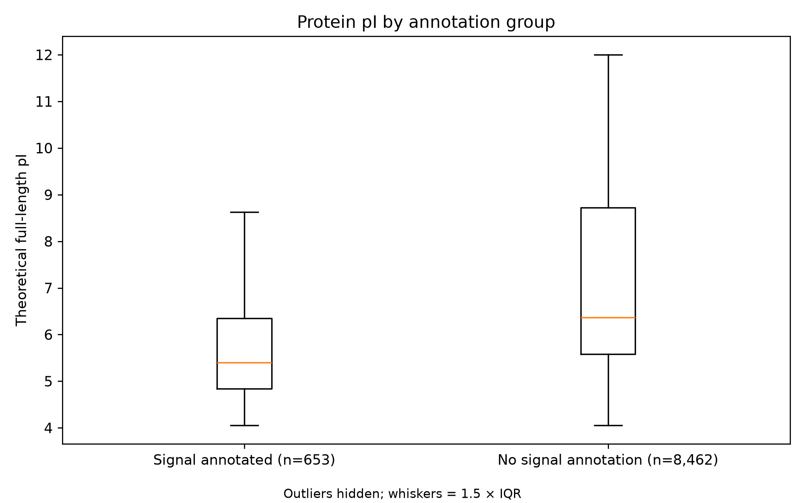
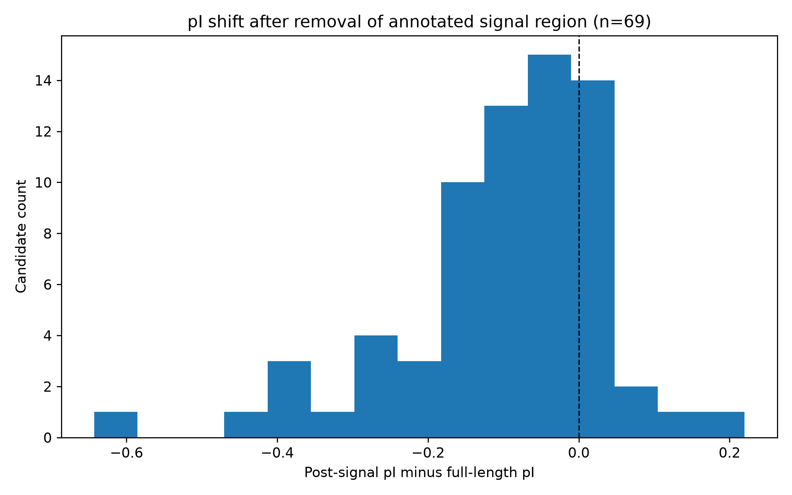

# UniProt annotation screen of putative secreted glycosidases in *Trichoderma reesei*

A Python/Biopython analysis of the public QM6a proteome. The aim is to identify proteins with **both** an annotated N-terminal `Signal` feature and a complete glycosidase EC number (`3.2.1.*`), inspect the strength of their annotation evidence, and calculate theoretical sequence properties.

This is an **annotation screen**, not experimental secretome profiling, enzyme activity testing, or an estimate of industrial production yield.

## Biological question and approach

*Trichoderma reesei* is relevant to enzyme biotechnology. I used the public UniProtKB proteome of its QM6a reference strain (`UP000008984`, NCBI Taxonomy ID `431241`), rather than data from laboratory samples or a company's production strain.

The pipeline:

1. Retrieves all UniProtKB records through the paginated REST API and saves the retrieval metadata.
2. Reads `Signal` features, their evidence codes/sources, and structured EC annotations from JSON.
3. Distinguishes **annotated Signal** from **no Signal annotation**. The second label is not equivalent to intracellular or non-secreted.
4. Counts complete EC numbers matching `3.2.1.<integer>`; incomplete entries such as `3.2.1.-` are not counted as matches.
5. Computes sequence length, theoretical molecular weight, and pI with Biopython from the complete precursor sequence.
6. For records with usable N-terminal signal-region coordinates, separately computes properties of the **post-signal segment**. This is an approximation based on annotation, **not a verified mature protein sequence**.
7. Creates descriptive figures and a ten-entry EC-diverse shortlist. The shortlist is not a performance ranking.

The EC rule defines an **EC-based glycosidase subset**, not a CAZy glycoside-hydrolase-family assignment. Some carbohydrate-active proteins will be missed.

## Results from the 22 November 2026 snapshot

| Observation | Number |
|---|---:|
| UniProtKB proteome entries | 9,115 |
| Entries with annotated Signal feature | 653 (7.16%) |
| Entries without annotated Signal feature | 8,462 (92.84%) |
| Entries with complete EC `3.2.1.*` | 108 |
| Entries meeting both conditions | 69 |
| Signal-annotated entries without an EC annotation | 506 |
| Full-length MW/pI calculations completed | 9,114 |
| Unsupported amino-acid sequence (`X`) | 1 |

Among full-length protein sequences, the median lengths were **391** versus **412** amino acids, and theoretical median pI values were **5.403** versus **6.366**, for Signal-annotated versus no-Signal-annotation groups. These are descriptive comparisons, not claims that secretion causes a pI difference.

An important follow-up question is why **39 of the 108** complete EC-matched proteins have no annotated Signal feature. The current pipeline does not classify these as intracellular; missing annotation or alternative targeting are among the possibilities.

### Evidence, IQR, post-signal properties and outliers

The **generated [detailed analysis report](results/analysis_report.md)** provides the observed evidence-code counts among the 69 candidates, reviewed-entry counts, group IQRs, post-signal-segment pI changes, the longest annotated protein, and examples of EC-matched proteins without Signal annotations. The source counts and provenance are also available as JSON in `results/analysis_details.json` and `results/metadata.json`.

`ECO:0000256` refers to a sequence-model match used in an automatic assertion; `ECO:0000255` is the corresponding type used in a manual assertion. Neither is experimental proof of protein secretion. Different codes, if present, need to be evaluated individually.

### Shortlist

The pipeline selected ten representative proteins across distinct EC categories, including chitinase (`G0R6S5`), endoglucanase EG-II (`G0RB67`), beta-glucosidase cel3A (`G0RG24`), and xylanase 3 (`G0RA32`). The full ten-entry table, evidence codes, calculated properties and selection reasons are in [`results/candidate_shortlist.csv`](results/candidate_shortlist.csv). All 69 candidates are in [`results/candidates.csv`](results/candidates.csv).

Candidates are selected by EC-category diversity (categories ordered by frequency), with reviewed annotation status, name completeness and accession used as deterministic tie-breakers. No enzyme activity, secretion efficiency or commercial value is inferred.

## Figures






Other figures: [signal-annotation counts](figures/signal_annotation_fraction.png) and [full-length protein length](figures/protein_length_comparison.png). In boxplots, outliers are hidden visually; all valid data are included when computing quartiles. Default whiskers extend to 1.5 times the IQR.

## Reproduce the analysis

Python 3 and the dependencies in `requirements.txt` are needed. Run these commands from the repository root:

```bash
python3 -m venv .venv
source .venv/bin/activate
python -m pip install -r requirements.txt

python src/fetch_proteome.py
python src/parse_annotations.py
python src/calculate_properties.py
python src/select_candidates.py
python src/make_figures.py
python src/audit_pipeline.py
python -m pytest tests/ -q
```

The full raw UniProt JSON (`data/proteome_records.json`) is not committed because it can be retrieved by the script. Results may change after UniProt updates; refer to `results/metadata.json` for the exact retrieval time and release, when reported by the API.

Unit tests use **synthetic** protein records and cover signal annotations, evidence categories, EC parsing, post-signal coordinates, sequence properties and shortlist logic. `src/audit_pipeline.py` performs an additional **data-driven consistency audit** and writes a reproducible report; passing tests is not equivalent to experimental validation.

## Limitations and decisions

I intentionally used UniProt feature annotations instead of presenting this work as a newly trained secretion predictor. This made the selection rule easy to inspect, but many annotations depend on computational evidence and can be incomplete or incorrect. A Signal annotation means targeting to a secretory pathway may be plausible, not that the protein was measured in culture supernatant. An absent Signal annotation is not a biological negative.

The post-signal calculation removes only the segment described by a usable annotated N-terminal `Signal` feature; it does not model propeptides, other processing, glycosylation or experimental cleavage. The theoretical pI and MW values also do not predict production titers. Very long sequences and uncertain gene models deserve external validation, which is outside the scope of this project.

A shortlist chosen for EC diversity should not be read as the ten best enzymes. A next step could compare known secreted enzymes against the screen and inspect proteins with uncertain Signal annotations, but I have not claimed to complete those analyses.

## Authorship and tools

This is a personal portfolio project using public data, not work commissioned by Picea or another company. **AI assistance was used to draft and revise parts of the Python code and documentation.** I executed the scripts on the dataset, reviewed their outputs and limitations, and kept checks and data provenance reproducible. The repository records the computational work, not independent laboratory experiments.

Data and software: [UniProtKB](https://www.uniprot.org/), [UniProt REST API](https://www.uniprot.org/api-documentation/uniprotkb), [UniProt signal annotation](https://www.uniprot.org/help/signal), [Biopython ProteinAnalysis](https://biopython.org/wiki/ProtParam), pandas, matplotlib, requests and pytest.
