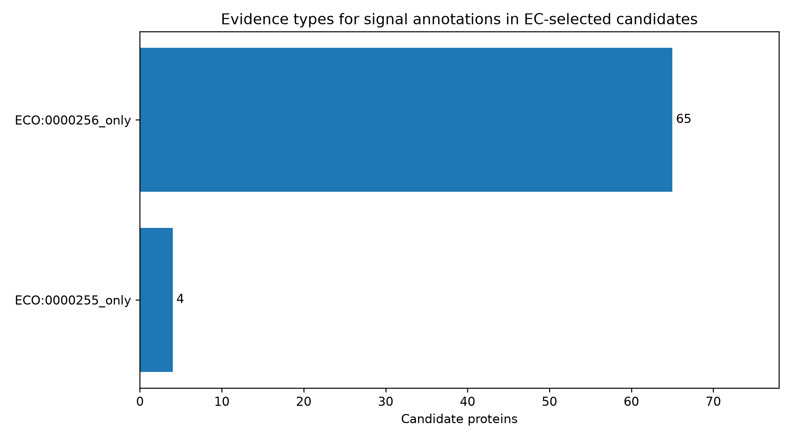
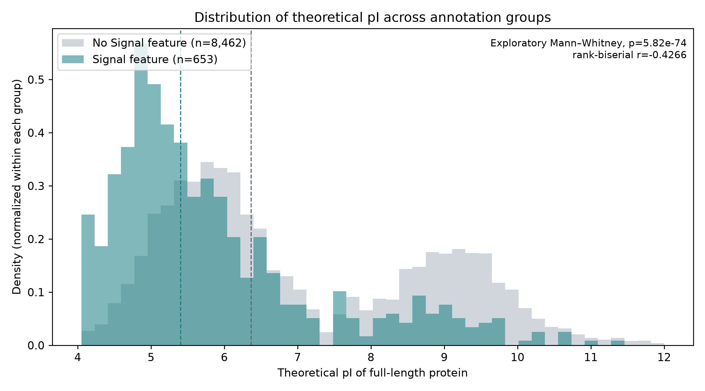

# Screening putative secreted glycosidases in *Trichoderma reesei*

Python/Biopython analysis of the public QM6a proteome (`UP000008984`). I looked for proteins with both an annotated N-terminal signal peptide and a complete EC `3.2.1.*` number, then examined the evidence behind those annotations and calculated protein-sequence properties.

**Scope:** a personal computational portfolio project based on public UniProt records. This is **not** an experimentally measured secretome, a CAZy-family classification, or a prediction of industrial enzyme yield.

## Research question and method

Can UniProtKB feature annotations produce a reproducible list of *potential* extracellular glycosidases, and what information is lost when only EC numbers and Signal features are used?

The pipeline downloads the QM6a proteome using the UniProt REST API, checks accession uniqueness, extracts annotated Signal features and their evidence codes, and parses complete EC numbers with the pattern `3.2.1.<integer>`. It then uses Biopython to calculate theoretical molecular weight, protein length and pI from full-length sequences.

For proteins with a usable N-terminal Signal feature, it also calculates properties **after removing the annotated signal region**. These are *post-signal sequences*, not experimentally verified mature proteins. Finally, it reports missing annotation, selects EC-diverse examples, checks named reference enzymes, and runs an exploratory distribution comparison.

## Key findings

<!-- AUTO_RESULTS_BEGIN -->
The table below is generated from the CSV outputs by `python src/audit_pipeline.py`.
**Snapshot:** 2026-11-22T22:12:38.267306+00:00; UniProt release: 2026_04.  

| Observation | Count |
|---|---:|
| UniProt entries | 9,115 |
| Signal annotations | 653 (7.16%) |
| No Signal annotation | 8,462 |
| Complete EC `3.2.1.*` | 108 |
| Signal + complete EC candidates | 69 |
| Complete EC but no Signal annotation | 39 |
| Entries with incomplete `3.2.1.-` annotation | 11 |
| Full-length MW/pI calculated | 9,114 |

**Signal-feature evidence among the EC-selected candidates:**

| Evidence code category | Candidates |
|---|---:|
| `ECO:0000255_only` | 4 |
| `ECO:0000256_only` | 65 |
| **Reviewed UniProt entries among candidates** | **4** |

The ECO:0000255 and ECO:0000256 groups describe sequence-model evidence
(manual vs automatic assertions). When these are the only observed groups,
**no experimental evidence codes were found in the extracted Signal features**;
this does not assess all published experimental evidence.

**Full-length sequence summaries (median and IQR):**

| Annotation group | Valid pI | Median pI | pI IQR (Q1–Q3) | Median length (aa) | Length IQR (Q1–Q3) |
|---|---:|---:|---|---:|---|
| Signal annotated | 653 | 5.403 | 4.836–6.353 | 391.0 | 241.0–545.0 |
| No Signal annotation | 8461 | 6.366 | 5.585–8.719 | 412.0 | 264.0–607.0 |

**Exploratory two-sided Mann–Whitney U (full-length pI):** `U=1583906.5`, `p=5.82e-74`, rank-biserial effect `r=-0.4266` (positive values indicate higher ranks in the Signal-annotated group).
The test compares distributions; it does not prove secretion or a causal difference.

**After removal of the annotated signal segment:** 69 candidates had calculable theoretical pI; median post-signal minus full-length pI = **-0.074**. This is not a verified mature-protein measurement.

**TM check:** 4 candidate(s) have an annotated Transmembrane region extending beyond the Signal region. This is a possible membrane-association flag, not a secretion assay.

**Sequence outlier:** `G0RTM6` has 20,873 residues; the predicted gene model was not independently validated.
<!-- AUTO_RESULTS_END -->

**Interpretation.** `ECO:0000256` represents an automatic sequence-model assertion, whereas `ECO:0000255` is sequence-model evidence used in a manual assertion. These annotations do **not** demonstrate extracellular secretion experimentally. Likewise, lacking a Signal feature is not evidence that a protein is intracellular. The Mann–Whitney comparison is exploratory: a p-value is not a measure of biological importance or causation.

## Visualizations






Supplementary plots: [protein length](figures/protein_length_comparison.png), [full-length pI boxplot](figures/theoretical_pi_comparison.png), and [Signal annotation counts](figures/signal_annotation_fraction.png). Boxplot whiskers extend to 1.5×IQR; individual outliers are hidden only in the boxplot display and remain in the underlying statistics.

## Candidate selection and reference checks

The primary filter is deliberately simple: an annotated Signal feature **and** a complete EC `3.2.1.*` number. The [full candidate table](results/candidates.csv) retains all matching records. A [ten-protein shortlist](results/candidate_shortlist.csv) illustrates different EC categories; it is **not** a ranking of catalytic activity or commercial potential.

The [reference check](results/reference_check.csv) examines previously named proteins such as CBH I/Cel7A, CBH II/Cel6A, EG II/Cel5A and Xylanase II/Xyn2, with eIF5A as a comparison. The check searches supplied accession IDs or gene names; unresolved records are reported rather than assumed. Cel7A is an example of why strict EC filtering can miss a biologically interesting enzyme when the database lists an incomplete EC number. This small check is not a formal assessment of sensitivity or specificity.

Of the EC-matched proteins lacking Signal annotation, the [separate table](results/ec_without_signal.csv) preserves all records for further investigation. We cannot infer their intracellular location from that missing annotation alone.

## How to reproduce

Use Python 3.11–3.14 and an Internet connection for the *first* download. From the project root:

```bash
python3 -m venv .venv
source .venv/bin/activate
python -m pip install -r requirements.txt
bash run_pipeline.sh
```

The script uses the local `data/proteome_records.json` snapshot if present, otherwise retrieves it from UniProt; that raw, regenerable file is intentionally excluded from Git. To force a fresh retrieval, run `python src/fetch_proteome.py` before `bash run_pipeline.sh`.

The reproducible report is [results/analysis_report.md](results/analysis_report.md), with machine-readable values in [analysis_details.json](results/analysis_details.json) and source version/date in [metadata.json](results/metadata.json). Results may change in later UniProt releases. Unit tests use small synthetic examples, and GitHub Actions runs those tests without requiring the raw proteome. The audit additionally checks source/CSV counts, unique accessions, selection criteria and candidate membership.

## Decisions and limitations

I chose the public QM6a reference proteome because it can be fetched and reanalysed without access to proprietary strains or laboratory samples. I used the existing UniProt Signal annotations to keep the classification transparent rather than treating the project as a new signal-peptide predictor. EC `3.2.1.*` makes a clear, testable subset, but it is **not the same as a CAZy GH family assignment** and omits proteins with incomplete EC labels (and other carbohydrate-active enzymes).

My initial comparison used full-length precursor proteins. I later added a separate post-signal calculation after noticing that signal peptides are usually cleaved; this still does not model additional processing, glycosylation or prove the true cleavage site. I also retained the extreme long-sequence record as an outlier rather than silently deleting it; its underlying gene model needs independent validation.

Many Signal annotations are computationally inferred. Missing Signal annotation does not mean absent secretion, and no signal feature or EC annotation confirms enzyme activity, protein recovery from culture supernatant or industrial yield. The selected shortlist deliberately represents *annotation diversity*, not experimentally supported performance.

## Authorship and sources

**AI assistance** was used in drafting and revising parts of the scripts and documentation. I ran the pipeline on the UniProt data, checked the outputs, and reviewed the reported limitations. This project does not use my university laboratory samples.

Primary sources: [UniProtKB](https://www.uniprot.org/), [UniProtKB REST API](https://www.uniprot.org/api-documentation/uniprotkb), [UniProt Signal peptide help](https://www.uniprot.org/help/signal), [UniProt evidence explanation](https://www.ebi.ac.uk/training/online/courses/uniprot-exploring-protein-sequence-and-functional-info/where-does-the-data-come-from/data-evidence/), [Biopython ProtParam](https://biopython.org/wiki/ProtParam), and [SciPy Mann–Whitney U documentation](https://docs.scipy.org/doc/scipy/reference/generated/scipy.stats.mannwhitneyu.html).
